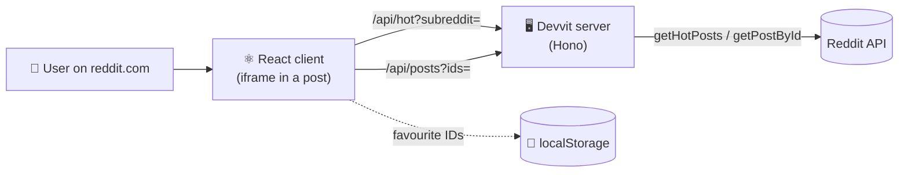

<div align="center">

# ⭐ Reddit Favourites

**A Devvit app that runs inside a Reddit post: browse any subreddit's 10 hottest posts and save your favourites.**


</div>

---

## ✨ Features

- 🔥 **Browse**: enter a subreddit name and see its 10 hottest posts
- ⭐ **Favourite**: save any post with one click
- 📂 **Favourites tab**: view saved posts and remove them
- 🖥️ **Full screen**: open the app in an expanded view
- 🔑 **No API keys**: the server calls the Reddit API through Devvit, so there are no keys to manage and no CORS issues

## 🧩 Architecture



| Layer | Tech | Role |
|---|---|---|
| **Client** | React + TypeScript, built with Vite | UI that runs in an iframe on reddit.com |
| **Server** | Devvit Web server (Hono) | `/api/hot` and `/api/posts`, plus the mod menu action and install trigger |
| **Storage** | Browser `localStorage` | Stores only favourite post IDs; details are fetched fresh from Reddit |

## 🚀 Getting Started

### Prerequisites

- [Node.js](https://nodejs.org/) 24+
- A Reddit account

### Run locally (playtest)

```sh
git clone https://github.com/Happytyagi1/reddit-favourites.git
cd reddit-favourites/reddit-favourites-devvit
npm install
npm run login     # log in to Devvit (opens a browser)
npm run dev       # builds, uploads, and gives you a test subreddit URL
```

In the test subreddit, open the mod menu (**•••**) → **Create Reddit Favourites post**, then open the post to use the app.

> 💡 If the app name `happy-assignment1` is already taken, change `name` in `devvit.json`.

### Deploy

```sh
npm run deploy    # type-check, lint, and upload a new version
npm run launch    # deploy and submit the app for review / publishing
```

To share it, install the app on a **public** subreddit you moderate (from [developers.reddit.com/apps](https://developers.reddit.com/apps)), create the post and share its link.

## 📁 Project Structure

```
reddit-favourites-devvit/
├── devvit.json          # App config: name, post entrypoint, menu, triggers
├── src/
│   ├── client/          # React UI: game.tsx, PostItem, useFavourites hook
│   ├── server/          # API routes: /api/hot, /api/posts, menu + install trigger
│   └── shared/          # Types shared by client and server
└── tools/               # TypeScript configs
```

## 📄 License

BSD-3-Clause. See [LICENSE](reddit-favourites-devvit/LICENSE).

<div align="center">

Made with ❤️ by **Happy Tyagi**

</div>
